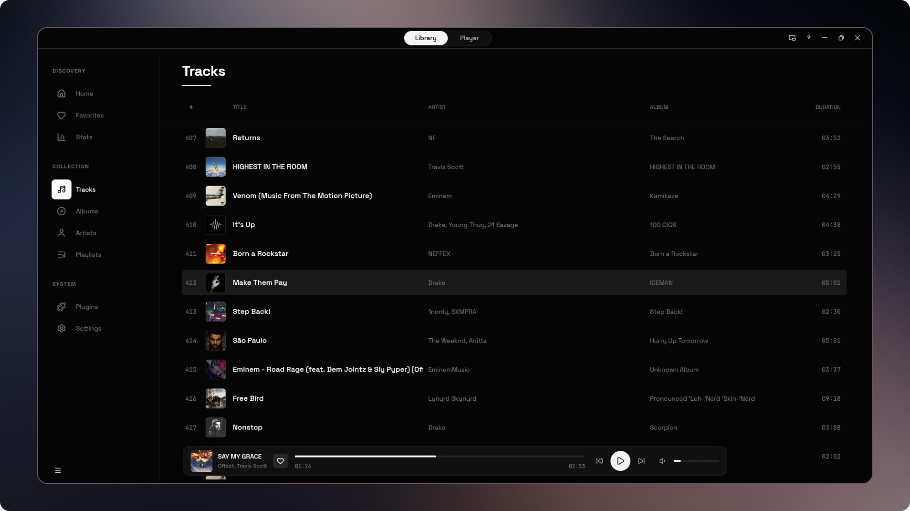

<p align="center">
  
</p>

<table align="center">
  <tr>
    <td align="center" width="33%">
      <a href="#installation">
        
      </a>
    </td>
    <td align="center" width="33%">
      <a href="#documentation">
        
      </a>
    </td>
    <td align="center" width="33%">
      <a href="https://discord.gg/gWkxZuqfKT">
        
      </a>
    </td>
  </tr>
</table>

<p align="center">
    
    
    
    
    
</p>





Wiremann is a native desktop music player for local files, written in Rust. It uses [WGPUI](https://github.com/Far-Beyond-Pulsar/WGPUI) for the interface and [WGPU](https://github.com/gfx-rs/wgpu) for GPU rendering. Audio is handled fully natively in Rust by [Rodio](https://github.com/rustaudio/rodio).

It's got library management, playback, lyrics, listening stats and a bunch of other stuff. Pretty much everything you need to manage a local music collection.

## Getting Wiremann

Prebuilt versions are available on the [Releases page](https://github.com/wiremann/wiremann/releases/latest). Grab the one for your platform and you're good to go.

### Windows

Both x86-64 and ARM64 builds are available.

**Installer (recommended)**

1. Head over to the [latest release](https://github.com/wiremann/wiremann/releases/latest).
2. Download `WiremannSetup-x86_64.exe` (64-bit PCs) or `WiremannSetup-aarch64.exe` (ARM64), depending on your system.
3. Run the installer and follow the instructions.
4. Launch Wiremann from the Start menu or desktop shortcut.

**Portable**

Don't want an installer? That's fine too.

Download `wiremann-x86_64.exe` or `wiremann-aarch64.exe` from the same release and run it. No installation required.

### Linux

Currently, prebuilt Linux binaries are available for x86-64.

1. Download `wiremann-linux-x86_64.tar.gz` from the [latest release](https://github.com/wiremann/wiremann/releases/latest).
2. Open a terminal in the directory where you downloaded it.
3. Extract the archive:

```bash
tar -xzf wiremann-linux-x86_64.tar.gz
```

4. Enter the extracted directory and launch Wiremann:

```bash
cd wiremann-x86_64
./wiremann
```

That's it. The archive also includes an icon and a `.desktop` file.

### macOS

Both Intel and Apple Silicon builds are available.

You can download either a DMG or an app ZIP:

| Architecture | DMG | ZIP |
|---|---|---|
| Intel (x86-64) | `Wiremann-x86_64.dmg` | `Wiremann-x86_64.app.zip` |
| Apple Silicon (ARM64) | `Wiremann-aarch64.dmg` | `Wiremann-aarch64.app.zip` |

**Using the DMG:**

1. Download the appropriate DMG.
2. Open it.
3. Drag Wiremann into your Applications folder.
4. Launch it from Applications.

**Using the ZIP:**

Extract the archive, move `Wiremann.app` into Applications, and launch it.

One thing worth knowing: macOS builds aren't currently signed or notarized. Gatekeeper might complain on first launch. If that happens, open **System Settings → Privacy & Security** and use **Open Anyway** for the official Wiremann download.

### Building from source

Want to build it yourself? You'll need a stable Rust toolchain with Rust 2024 edition support. If you're on GNU/Linux, you'll need to install some dependencies (see [Linux Dependencies](#linux-dependencies))

```bash
git clone https://github.com/wiremann/wiremann.git
cd wiremann
cargo run
```

For an optimized release build:

```bash
cargo build --release
```

The executable will be available under `target/release/`.

#### Linux Dependencies

<details>
    <summary>
        <h4>Ubuntu/Debian</h4>
    </summary>

  ```bash
  sudo apt-get update
  sudo apt-get install -y \
    build-essential \
    libasound2-dev \
    pkg-config \
    libxkbcommon-dev \
    libxkbcommon-x11-dev \
    libx11-xcb-dev \
    libfontconfig1-dev \
    libwayland-dev \
    libxcb-render0-dev \
    libxcb-shape0-dev \
    libxcb-xfixes0-dev \
    libssl-dev \
    libdbus-1-dev
  ```

</details>

<details>
    <summary>
        <h4>Arch Linux</h4>
    </summary>

  ```bash
sudo pacman -S --needed \
  base-devel \
  pkgconf \
  clang \
  openssl \
  fontconfig \
  freetype2 \
  alsa-lib \
  dbus \
  libxkbcommon \
  libxkbcommon-x11 \
  libx11 \
  libxcb \
  wayland
  ```

</details>

<details>
    <summary>
        <h4>Fedora</h4>
    </summary>

  ```bash
sudo dnf install \
  gcc gcc-c++ make \
  pkgconf-pkg-config \
  clang \
  openssl-devel \
  fontconfig-devel \
  freetype-devel \
  alsa-lib-devel \
  dbus-devel \
  libxkbcommon-devel \
  libxkbcommon-x11-devel \
  libX11-devel \
  libxcb-devel \
  wayland-devel
  ```

</details>

<details>
    <summary>
        <h4>openSuse</h4>
    </summary>

  ```bash
  sudo zypper install \
    gcc gcc-c++ make \
    pkg-config \
    clang \
    libopenssl-devel \
    fontconfig-devel \
    freetype2-devel \
    alsa-devel \
    dbus-1-devel \
    libxkbcommon-devel \
    libX11-devel \
    libxcb-devel \
    wayland-devel
  ```

</details>

## Features

### Your library

Add a folder and Wiremann will scan it for `.mp3`, `.wav`, `.ogg`, `.aac` and `.m4a` files. It reads metadata and embedded artwork using Lofty, then organizes everything into tracks, albums and artists.

You get separate views for tracks, albums, artists, favorites and playlists. Folder-based playlists are created automatically when you add a music directory.

Scans are incremental too. Unchanged files don't need to have their metadata read all over again. If tags are missing or a bit of a mess, Wiremann can fall back to filename formats like `Artist - Title` and `Artist: Title`.

There's also a queue, shuffle, repeat, keyboard shortcuts, volume and playback controls, and a pop-out player.

### Lyrics

Lyrics are fetched through YouLY, with LRCLIB as a fallback.

Line-synchronized, word-synchronized and plain lyrics are supported, depending on what's available from the providers. Word-level timing gets its own animated highlighting, so you can follow along properly.

Found lyrics are cached locally, so Wiremann doesn't have to fetch them again every time.

### Listening stats

Wiremann keeps track of play counts, listening time, skips, and first and last listen dates.

The stats page brings all of that together, with your top tracks, artists and albums. A little listening history, basically.

### Artwork

Embedded artwork takes priority. If a track doesn't have any, Wiremann looks up its cover on Deezer and downloads it.

Thumbnails and playlist artwork are generated and cached locally. Playlist covers can even combine artwork from multiple albums.

## Under the hood

Wiremann is written entirely in Rust. The UI runs on GPUI and WGPUI, with GPU-backed rendering.

A few other things doing the heavy lifting:

- **Rodio + Symphonia** for audio playback and decoding.
- **Lofty** for metadata and embedded artwork.
- **SQLite + SQLx** for library data, playlists, queue, favorites and listening metrics.
- **Crossbeam** for communication between the UI and background workers.
- **Reqwest** for lyrics and artwork requests.
- **WGPUI Motion** for UI animations.

The scanner, audio engine, image processor, lyrics manager and other components run in separate workers. This keeps the expensive stuff away from the UI thread.

SQLite operations run through a small Tokio runtime inside the database worker. The rest of the application isn't built around Tokio.

## Privacy

No account or sign-in required. Your library, playback state, favorites and listening stats are stored locally.

Wiremann does make a few external requests:

- **YouLY and LRCLIB** for lyrics. Track titles and artist information are sent for matching.
- **Deezer** for album artwork. Track, artist or album information may be used in searches.

Artwork and lyrics are cached locally. No first-party telemetry or analytics implementation is present.

## Contributing

Found something broken? Have an idea? Feel free to open an issue or submit a pull request.

For Rust changes, run the usual checks before submitting:

```bash
cargo fmt --check
cargo test
cargo clippy --all-targets --all-features
```

Keep changes focused, and update screenshots or documentation when relevant.

## License

Wiremann is licensed under the GNU General Public License v3.0.

See [LICENSE](LICENSE) or the [official GPL v3 text](https://www.gnu.org/licenses/gpl-3.0.en.html).
